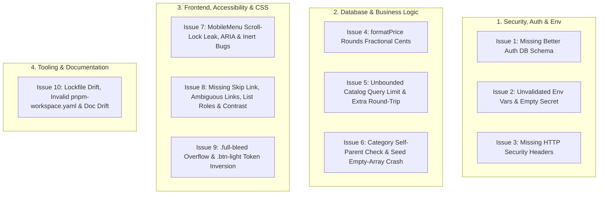

# Code Review & Remediation Plan — Atelier Store

## Goal Description

Perform a comprehensive code, security, correctness, accessibility, and configuration review of `atelier-store` (Next.js 16 App Router, TypeScript, Tailwind CSS v4, Better Auth, and Drizzle ORM on Neon Postgres), list all identified issues by severity, and propose concrete fixes for each.



---

## Summary of Issues Found

| # | Category | Severity | File(s) | Issue Summary |
| :- | :--- | :--- | :--- | :--- |
| **1** | Auth / Runtime Error | **High** | [auth.ts](file:///home/loren/atelier-store/src/lib/auth.ts), [index.ts](file:///home/loren/atelier-store/src/db/schema/index.ts), [route.ts](file:///home/loren/atelier-store/src/app/api/auth/%5B...all%5D/route.ts) | Better Auth is wired to `drizzleAdapter(db)` and mounted at `/api/auth/[...all]`, but the Better Auth schema (`src/db/schema/auth.ts`) and tables (`user`, `session`, `account`, `verification`) have not been generated or exported, causing all `/api/auth/*` requests to fail at runtime. |
| **2** | Security / Config | **High** | [index.ts](file:///home/loren/atelier-store/src/db/index.ts), [auth.ts](file:///home/loren/atelier-store/src/lib/auth.ts), [auth-client.ts](file:///home/loren/atelier-store/src/lib/auth-client.ts), [drizzle.config.ts](file:///home/loren/atelier-store/drizzle.config.ts) | `DATABASE_URL` uses unsafe non-null assertions (`!`) without validation; `.env` has an empty `BETTER_AUTH_SECRET=""` (causing Better Auth to log a secret error / fall back to an insecure default); `authClient` unconditionally passes `NEXT_PUBLIC_APP_URL`. |
| **3** | Security | **Medium** | [next.config.ts](file:///home/loren/atelier-store/next.config.ts) | No HTTP security headers (`X-Content-Type-Options`, `X-Frame-Options`, `Referrer-Policy`, `Permissions-Policy`, `Cross-Origin-Opener-Policy`, `Content-Security-Policy` `frame-ancestors`) are configured. |
| **4** | Bug / Logic | **Medium** | [format.ts](file:///home/loren/atelier-store/src/lib/format.ts) | [`formatPrice`](file:///home/loren/atelier-store/src/lib/format.ts#L7-L9) sets `maximumFractionDigits: 0`, which rounds any non-whole-dollar cent amount (e.g. `1950` cents = `$19.50` displays as `"$20"`, `49` cents = `$0.49` displays as `"$0"`). |
| **5** | Reliability / Perf | **Medium** | [catalog.ts](file:///home/loren/atelier-store/src/lib/catalog.ts) | [`getProductsInCategory`](file:///home/loren/atelier-store/src/lib/catalog.ts#L60-L91) executes an unbounded `SELECT` when `limit` is omitted, does not validate/clamp negative or excessive `limit` values, and performs 2 sequential HTTP queries to Neon instead of 1. |
| **6** | Database / Seed | **Low–Med** | [catalog.ts](file:///home/loren/atelier-store/src/db/schema/catalog.ts), [seed.ts](file:///home/loren/atelier-store/src/db/seed.ts) | `categories` lacks a `CHECK (parent_id <> id)` constraint against self-parenting; [`upsertCategories`](file:///home/loren/atelier-store/src/db/seed.ts#L181-L200) crashes if passed an empty array `[]`; [`excluded`](file:///home/loren/atelier-store/src/db/seed.ts#L179) uses `sql.raw` instead of `sql.identifier`. |
| **7** | UI Bug / A11y | **Medium** | [mobile-menu.tsx](file:///home/loren/atelier-store/src/components/layout/mobile-menu.tsx), [site-header.tsx](file:///home/loren/atelier-store/src/components/layout/site-header.tsx) | Resizing viewport from mobile to desktop (`>= 1024px`) while the menu is open hides the close button via `.lg:hidden` while leaving `document.body.style.overflow = "hidden"` permanently stuck; `aria-controls="mobile-menu"` points to a non-existent ID when closed; duplicate `<nav aria-label="Main">` landmark; background content is not `inert` when menu is open; focus is not moved/restored. |
| **8** | Accessibility (a11y) | **Medium** | [layout.tsx](file:///home/loren/atelier-store/src/app/layout.tsx), [section-header.tsx](file:///home/loren/atelier-store/src/components/home/section-header.tsx), [product-showcase.tsx](file:///home/loren/atelier-store/src/components/home/product-showcase.tsx), [collection-grid.tsx](file:///home/loren/atelier-store/src/components/home/collection-grid.tsx), [service-strip.tsx](file:///home/loren/atelier-store/src/components/home/service-strip.tsx), [tokens.css](file:///home/loren/atelier-store/src/styles/tokens.css) | Missing "Skip to main content" link; duplicate `"View All"` link text pointing to different URLs (`/new` vs `/accessories`); CSS Grid `<ul>` elements lose list semantics in Safari/VoiceOver without `role="list"`; `--color-subtle` (`#9a9a9a` on `#ffffff`) has a 2.85:1 contrast ratio (fails WCAG AA). |
| **9** | CSS Bug | **Low–Med** | [components.css](file:///home/loren/atelier-store/src/styles/components.css), [base.css](file:///home/loren/atelier-store/src/styles/base.css) | `.full-bleed` uses `width: 100vw`, causing horizontal scrollbars when a vertical scrollbar is present; `.btn-light` uses `var(--color-paper)` / `var(--color-ink)` which invert inside `.theme-inverse`, turning `.btn-light` black instead of light. |
| **10** | Tooling / Docs | **Medium** | [pnpm-workspace.yaml](file:///home/loren/atelier-store/pnpm-workspace.yaml), [package-lock.json](file:///home/loren/atelier-store/package-lock.json), [CLAUDE.md](file:///home/loren/atelier-store/CLAUDE.md), [README.md](file:///home/loren/atelier-store/README.md) | `pnpm-workspace.yaml` has invalid string placeholders (`set this to true or false`); `package-lock.json` is out of sync with `package.json` (missing `tsx`, breaking `npm ci`); `CLAUDE.md` recommends single-argument `revalidateTag('catalog')` which is deprecated in Next.js 16; `README.md` references outdated paths (`src/db/schema.ts`) and fonts (`Geist`). |

---

## Open Questions

> [!IMPORTANT]
> Before I apply any fixes, please confirm:
> 1. **Better Auth Schema (Issue 1):** Would you like me to generate `src/db/schema/auth.ts` and its SQL migration now, or keep auth tables ungenerated until you build the auth UI?
> 2. **Package Manager (Issue 10):** Both `package-lock.json` and `pnpm-lock.yaml` are committed. Which package manager (`npm` or `pnpm`) should be canonical for this repository so we can remove or sync the lockfiles cleanly?

---

## Proposed Changes

### Component 1: Authentication, Environment Validation & Security Headers

#### [NEW] `src/db/schema/auth.ts` & [MODIFY] [index.ts](file:///home/loren/atelier-store/src/db/schema/index.ts)
- **Issue 1:** Calling any `/api/auth/*` endpoint currently fails because `drizzleAdapter(db, { provider: "pg" })` cannot find the Better Auth tables in `schema`.
- **Fix:** Run `npm run auth:generate` to generate `src/db/schema/auth.ts`, re-export it from `src/db/schema/index.ts`, and generate the corresponding Drizzle migration (`npm run db:generate`).

```diff
--- a/src/db/schema/index.ts
+++ b/src/db/schema/index.ts
@@ -1,5 +1,4 @@
 // Drizzle table definitions. Every table must be re-exported here so it is
 // visible to db.query.* and drizzle-kit.
-// Better Auth tables: run `npm run auth:generate` (writes ./auth.ts), then add
-// `export * from "./auth";` below.
+export * from "./auth";
 export * from "./catalog";
```

#### [MODIFY] [index.ts](file:///home/loren/atelier-store/src/db/index.ts), [drizzle.config.ts](file:///home/loren/atelier-store/drizzle.config.ts), & [auth-client.ts](file:///home/loren/atelier-store/src/lib/auth-client.ts)
- **Issue 2:** Replace unsafe `process.env.DATABASE_URL!` non-null assertions with explicit validation that throws an actionable error message if `DATABASE_URL` is missing, and make `baseURL` conditional in `src/lib/auth-client.ts`. (Also populate `BETTER_AUTH_SECRET` in local `.env` if desired.)

```diff
--- a/src/db/index.ts
+++ b/src/db/index.ts
@@ -3,6 +3,10 @@ import { drizzle } from "drizzle-orm/neon-http";
 
 import * as schema from "./schema";
 
-const sql = neon(process.env.DATABASE_URL!);
+const databaseUrl = process.env.DATABASE_URL;
+if (!databaseUrl) {
+  throw new Error("DATABASE_URL environment variable is not set.");
+}
+
+const sql = neon(databaseUrl);
 
 export const db = drizzle({ client: sql, schema });
```

```diff
--- a/src/lib/auth-client.ts
+++ b/src/lib/auth-client.ts
@@ -1,5 +1,7 @@
 import { createAuthClient } from "better-auth/react";
 
 export const authClient = createAuthClient({
-  baseURL: process.env.NEXT_PUBLIC_APP_URL,
+  ...(process.env.NEXT_PUBLIC_APP_URL
+    ? { baseURL: process.env.NEXT_PUBLIC_APP_URL }
+    : {}),
 });
```

#### [MODIFY] [next.config.ts](file:///home/loren/atelier-store/next.config.ts)
- **Issue 3:** Add preventative HTTP security headers to all routes in `next.config.ts`.

```diff
--- a/next.config.ts
+++ b/next.config.ts
@@ -1,5 +1,33 @@
 import type { NextConfig } from "next";
 
+const securityHeaders = [
+  {
+    key: "X-Content-Type-Options",
+    value: "nosniff",
+  },
+  {
+    key: "X-Frame-Options",
+    value: "SAMEORIGIN",
+  },
+  {
+    key: "Referrer-Policy",
+    value: "strict-origin-when-cross-origin",
+  },
+  {
+    key: "Cross-Origin-Opener-Policy",
+    value: "same-origin-allow-popups",
+  },
+  {
+    key: "Permissions-Policy",
+    value: "camera=(), geolocation=(), microphone=(), focus-without-user-activation=()",
+  },
+  {
+    key: "Content-Security-Policy",
+    value: "frame-ancestors 'self'; object-src 'none'; base-uri 'self';",
+  },
+];
+
 const nextConfig: NextConfig = {
   /* config options here */
   cacheComponents: true,
+  async headers() {
+    return [
+      {
+        source: "/(.*)",
+        headers: securityHeaders,
+      },
+    ];
+  },
   images: {
```

---

### Component 2: Database, Seed & Price Formatting Logic

#### [MODIFY] [format.ts](file:///home/loren/atelier-store/src/lib/format.ts)
- **Issue 4:** Fix `formatPrice` so whole-dollar amounts display without `.00` (e.g., `$2,450`) while fractional cent amounts display exact cents (e.g., `$19.50` instead of rounding to `$20`).

```diff
--- a/src/lib/format.ts
+++ b/src/lib/format.ts
@@ -1,9 +1,14 @@
 const priceFormatter = new Intl.NumberFormat("en-US", {
   style: "currency",
   currency: "USD",
-  maximumFractionDigits: 0,
+  minimumFractionDigits: 2,
+  maximumFractionDigits: 2,
+  trailingZeroDisplay: "stripIfInteger",
 });
 
 export function formatPrice(cents: number) {
+  if (!Number.isFinite(cents)) {
+    return "$0";
+  }
   return priceFormatter.format(cents / 100);
 }
```

#### [MODIFY] [catalog.ts](file:///home/loren/atelier-store/src/lib/catalog.ts)
- **Issue 5:** Clamp `limit` to a safe positive integer range (`1..100`), apply a sensible default limit in `getProductsInCategory`, and collapse `getProductsInCategory` from two sequential Neon HTTP queries into a single query.

```diff
--- a/src/lib/catalog.ts
+++ b/src/lib/catalog.ts
@@ -1,5 +1,5 @@
 // Read-only catalog queries for the storefront.
-import { and, asc, desc, eq, isNotNull, isNull, or } from "drizzle-orm";
+import { and, asc, desc, eq, inArray, isNotNull, isNull, or } from "drizzle-orm";
 import { cacheLife, cacheTag } from "next/cache";
 
 import { db } from "@/db";
@@ -21,6 +21,14 @@ export type Department = {
   imageUrl: string;
 };
 
+const DEFAULT_PRODUCT_LIMIT = 50;
+const MAX_PRODUCT_LIMIT = 100;
+
+function clampLimit(limit: number | undefined, fallback = DEFAULT_PRODUCT_LIMIT): number {
+  if (limit === undefined || !Number.isFinite(limit)) return fallback;
+  return Math.min(Math.max(1, Math.trunc(limit)), MAX_PRODUCT_LIMIT);
+}
+
 const summaryColumns = {
   slug: products.slug,
   name: products.name,
@@ -45,49 +53,48 @@ export async function getNewArrivals(limit = 8): Promise<ProductSummary[]> {
   cacheLife("hours");
   cacheTag("catalog");
 
+  const safeLimit = clampLimit(limit, 8);
+
   const rows = await db
     .select(summaryColumns)
     .from(products)
     .innerJoin(categories, eq(products.categoryId, categories.id))
     .where(eq(products.isActive, true))
     .orderBy(desc(products.createdAt), asc(products.id))
-    .limit(limit);
+    .limit(safeLimit);
 
   return rows.map(toSummary);
 }
 
 // Products in the category or any of its direct children.
 export async function getProductsInCategory(
   slug: string,
   limit?: number,
 ): Promise<ProductSummary[]> {
   "use cache";
   cacheLife("hours");
   cacheTag("catalog");
 
-  const category = await db.query.categories.findFirst({
-    columns: { id: true },
-    where: eq(categories.slug, slug),
-  });
-  if (!category) return [];
+  const safeLimit = clampLimit(limit);
+  const targetCategoryId = db
+    .select({ id: categories.id })
+    .from(categories)
+    .where(eq(categories.slug, slug));
 
-  const query = db
+  const rows = await db
     .select(summaryColumns)
     .from(products)
     .innerJoin(categories, eq(products.categoryId, categories.id))
     .where(
       and(
         eq(products.isActive, true),
         or(
-          eq(categories.id, category.id),
-          eq(categories.parentId, category.id),
+          inArray(categories.id, targetCategoryId),
+          inArray(categories.parentId, targetCategoryId),
         ),
       ),
     )
-    .orderBy(desc(products.createdAt), asc(products.id));
+    .orderBy(desc(products.createdAt), asc(products.id))
+    .limit(safeLimit);
 
-  const rows = limit === undefined ? await query : await query.limit(limit);
   return rows.map(toSummary);
 }
```

#### [MODIFY] [catalog.ts](file:///home/loren/atelier-store/src/db/schema/catalog.ts) & [seed.ts](file:///home/loren/atelier-store/src/db/seed.ts)
- **Issue 6:** Prevent self-referential `parent_id = id` in `categories`, guard against empty `rows` in `upsertCategories`, and replace `sql.raw` with `sql.identifier`.

```diff
--- a/src/db/schema/catalog.ts
+++ b/src/db/schema/catalog.ts
@@ -35,7 +35,13 @@ export const categories = pgTable(
     position: integer("position").notNull().default(0),
     ...timestamps,
   },
-  (t) => [index("categories_parent_id_idx").on(t.parentId)],
+  (t) => [
+    index("categories_parent_id_idx").on(t.parentId),
+    check(
+      "categories_parent_id_not_self",
+      sql`${t.parentId} IS NULL OR ${t.parentId} <> ${t.id}`,
+    ),
+  ],
 );
```

```diff
--- a/src/db/seed.ts
+++ b/src/db/seed.ts
@@ -176,11 +176,13 @@ const accessories: SeedProduct[] = [
   },
 ];
 
-const excluded = (column: string) => sql.raw(`excluded.${column}`);
+const excluded = (column: string) => sql`excluded.${sql.identifier(column)}`;
 
 async function upsertCategories(
   rows: (typeof categories.$inferInsert)[],
 ): Promise<Map<string, number>> {
+  if (rows.length === 0) return new Map();
+
   const saved = await db
     .insert(categories)
     .values(rows)
```

---

### Component 3: Frontend, Accessibility (a11y) & CSS Fixes

#### [MODIFY] [mobile-menu.tsx](file:///home/loren/atelier-store/src/components/layout/mobile-menu.tsx)
- **Issue 7:**
  1. Close the mobile menu automatically when the viewport crosses `lg` (`(min-width: 64rem)`) so `document.body.style.overflow = "hidden"` never gets stuck when resizing to desktop.
  2. Set `inert` on `<main>` and `<footer>` while the mobile menu is open so keyboard focus cannot escape into obscured page content behind the menu.
  3. Move focus into the first menu link when opened and return focus to the toggle button when dismissed via `Escape`.
  4. Only attach `aria-controls="mobile-menu"` when `open` is `true` (so it never points to an unmounted ID), and use `aria-label="Mobile"` to avoid colliding with the desktop `<nav aria-label="Main">` landmark.
  5. Keep `top` synchronized on `resize`/`scroll` while open.

```diff
--- a/src/components/layout/mobile-menu.tsx
+++ b/src/components/layout/mobile-menu.tsx
@@ -13,22 +13,47 @@ export function MobileMenu({ items }: { items: NavItem[] }) {
   // announcement bar is still on screen.
   const [top, setTop] = useState(0);
   const buttonRef = useRef<HTMLButtonElement>(null);
+  const navRef = useRef<HTMLElement>(null);
 
-  function toggle() {
+  function updateTop() {
     const header = buttonRef.current?.closest("header");
     setTop(header?.getBoundingClientRect().bottom ?? 0);
+  }
+
+  function toggle() {
+    updateTop();
     setOpen((v) => !v);
   }
 
   useEffect(() => {
     if (!open) return;
+
     document.body.style.overflow = "hidden";
-    const onKey = (e: KeyboardEvent) => e.key === "Escape" && setOpen(false);
+    const inertTargets = document.querySelectorAll<HTMLElement>("main, footer");
+    inertTargets.forEach((el) => {
+      el.inert = true;
+    });
+
+    const firstLink = navRef.current?.querySelector<HTMLElement>("a, button");
+    firstLink?.focus();
+
+    const onKey = (e: KeyboardEvent) => {
+      if (e.key === "Escape") {
+        setOpen(false);
+        buttonRef.current?.focus();
+      }
+    };
+
+    const mql = window.matchMedia("(min-width: 64rem)");
+    const onMediaChange = (e: MediaQueryListEvent) => {
+      if (e.matches) setOpen(false);
+    };
+
     window.addEventListener("keydown", onKey);
+    window.addEventListener("resize", updateTop, { passive: true });
+    window.addEventListener("scroll", updateTop, { passive: true });
+    mql.addEventListener("change", onMediaChange);
+
     return () => {
       document.body.style.overflow = "";
+      inertTargets.forEach((el) => {
+        el.inert = false;
+      });
       window.removeEventListener("keydown", onKey);
+      window.removeEventListener("resize", updateTop);
+      window.removeEventListener("scroll", updateTop);
+      mql.removeEventListener("change", onMediaChange);
     };
   }, [open]);
 
   return (
     <div className="lg:hidden">
       <button
         ref={buttonRef}
         type="button"
         className="btn-icon -ml-3"
         aria-label={open ? "Close menu" : "Open menu"}
         aria-expanded={open}
-        aria-controls="mobile-menu"
+        aria-controls={open ? "mobile-menu" : undefined}
         onClick={toggle}
       >
         {open ? <CloseIcon /> : <MenuIcon />}
       </button>
 
       {open && (
         <nav
+          ref={navRef}
           id="mobile-menu"
-          aria-label="Main"
+          aria-label="Mobile"
           style={{ top }}
           className="fixed inset-x-0 bottom-0 z-(--z-drawer) overflow-y-auto border-t bg-paper"
         >
```

#### [MODIFY] [layout.tsx](file:///home/loren/atelier-store/src/app/layout.tsx), [section-header.tsx](file:///home/loren/atelier-store/src/components/home/section-header.tsx), [product-showcase.tsx](file:///home/loren/atelier-store/src/components/home/product-showcase.tsx), [collection-grid.tsx](file:///home/loren/atelier-store/src/components/home/collection-grid.tsx), & [service-strip.tsx](file:///home/loren/atelier-store/src/components/home/service-strip.tsx)
- **Issue 8:**
  - Add a "Skip to main content" link in `src/app/layout.tsx` targeting `<main id="main-content" tabIndex={-1}>`.
  - Disambiguate repeated `"View All"` links in `SectionHeader` using `aria-label={`${linkLabel} ${title}`}` (preserving `"View All"` at the start for WCAG 2.5.3 Label in Name).
  - Add `role="list"` on CSS Grid `<ul>` elements outside `<nav>` to preserve list semantics in Safari/VoiceOver.

```diff
--- a/src/app/layout.tsx
+++ b/src/app/layout.tsx
@@ -29,8 +29,14 @@ export default function RootLayout({ children }: LayoutProps<"/">) {
       className={`${jost.variable} ${garamond.variable} h-full antialiased`}
     >
       <body className="min-h-full flex flex-col">
+        <a
+          href="#main-content"
+          className="sr-only focus:not-sr-only focus:fixed focus:top-2 focus:left-2 focus:z-(--z-drawer) focus:bg-ink focus:px-4 focus:py-2 focus:text-xs focus:tracking-label focus:text-paper focus:uppercase"
+        >
+          Skip to main content
+        </a>
         <SiteHeader />
-        <main className="flex-1">{children}</main>
+        <main id="main-content" tabIndex={-1} className="flex-1 focus:outline-none">
+          {children}
+        </main>
         <SiteFooter />
       </body>
     </html>
```

```diff
--- a/src/components/home/section-header.tsx
+++ b/src/components/home/section-header.tsx
@@ -20,7 +20,11 @@ export function SectionHeader({
         <h2 className="text-heading">{title}</h2>
       </div>
       {href && (
-        <Link href={href} className="text-label link shrink-0">
+        <Link
+          href={href}
+          aria-label={`${linkLabel} ${title}`}
+          className="text-label link shrink-0"
+        >
           {linkLabel}
         </Link>
       )}
```

```diff
--- a/src/components/home/product-showcase.tsx
+++ b/src/components/home/product-showcase.tsx
@@ -21,7 +21,7 @@ export function ProductShowcase({
     <section className="container-page section">
       <SectionHeader eyebrow={eyebrow} title={title} href={href} />
       {layout === "grid" ? (
-        <ul className="grid-products">
+        <ul role="list" className="grid-products">
           {products.map((product) => (
             <li key={product.slug}>
               <ProductCard product={product} />
             </li>
           ))}
         </ul>
       ) : (
-        <ul className="rail -mx-gutter scroll-px-gutter px-gutter md:mx-0 md:px-0">
+        <ul role="list" className="rail -mx-gutter scroll-px-gutter px-gutter md:mx-0 md:px-0">
```

```diff
--- a/src/components/home/collection-grid.tsx
+++ b/src/components/home/collection-grid.tsx
@@ -10,7 +10,7 @@ export async function CollectionGrid() {
   return (
     <section className="container-page section">
       <SectionHeader eyebrow="Explore" title="Shop by Category" />
-      <ul className="grid grid-cols-2 gap-1 lg:grid-cols-4 lg:gap-2">
+      <ul role="list" className="grid grid-cols-2 gap-1 lg:grid-cols-4 lg:gap-2">
```

```diff
--- a/src/components/home/service-strip.tsx
+++ b/src/components/home/service-strip.tsx
@@ -3,7 +3,7 @@ import { services } from "@/lib/sample-data";
 export function ServiceStrip() {
   return (
     <section className="container-page section-sm">
-      <ul className="grid border-t sm:grid-cols-2 lg:grid-cols-4">
+      <ul role="list" className="grid border-t sm:grid-cols-2 lg:grid-cols-4">
```

#### [MODIFY] [tokens.css](file:///home/loren/atelier-store/src/styles/tokens.css), [base.css](file:///home/loren/atelier-store/src/styles/base.css), & [components.css](file:///home/loren/atelier-store/src/styles/components.css)
- **Issues 8 & 9:**
  - Darken `--color-subtle` from `#9a9a9a` (2.85:1 contrast on white) to `#757575` (4.6:1 contrast on white) in `src/styles/tokens.css`.
  - Add `overflow-x: clip;` on `body` in `src/styles/base.css` to prevent `.full-bleed` (`100vw`) from causing horizontal scrollbars when vertical scrollbars are present.
  - Fix `.btn-light` in `src/styles/components.css` to use `--color-white` and `--color-black` so it stays light over imagery even inside `.theme-inverse` containers.

```diff
--- a/src/styles/tokens.css
+++ b/src/styles/tokens.css
@@ -18,7 +18,7 @@
   --color-ink-soft: #1f1f1f; /* hover on ink surfaces */
   --color-paper: #ffffff; /* page background */
   --color-muted: #6b6b6b; /* secondary text, meta, captions */
-  --color-subtle: #9a9a9a; /* placeholder, disabled text */
+  --color-subtle: #757575; /* placeholder, disabled text */
   --color-line: #e3e3e3; /* hairline borders, dividers */
```

```diff
--- a/src/styles/base.css
+++ b/src/styles/base.css
@@ -17,6 +17,7 @@
     font-size: var(--text-base);
     line-height: var(--text-base--line-height);
     font-weight: var(--font-weight-normal);
+    overflow-x: clip;
   }
```

```diff
--- a/src/styles/components.css
+++ b/src/styles/components.css
@@ -127,13 +127,13 @@
 /* Paper fill: CTAs placed over imagery */
 @utility btn-light {
-  background-color: var(--color-paper);
-  border-color: var(--color-paper);
-  color: var(--color-ink);
+  background-color: var(--color-white);
+  border-color: var(--color-white);
+  color: var(--color-black);
 
   &:hover:not(:disabled, [aria-disabled="true"]) {
     background-color: transparent;
-    color: var(--color-paper);
+    color: var(--color-white);
   }
 }
```

---

### Component 4: Tooling, Lockfiles & Documentation

#### [MODIFY] [pnpm-workspace.yaml](file:///home/loren/atelier-store/pnpm-workspace.yaml), [CLAUDE.md](file:///home/loren/atelier-store/CLAUDE.md), & [README.md](file:///home/loren/atelier-store/README.md)
- **Issue 10:**
  - Replace invalid placeholder text (`set this to true or false`) in `pnpm-workspace.yaml` with valid boolean values (or remove if standardizing on `npm`), and ensure lockfile consistency.
  - Update `CLAUDE.md` line 46 from deprecated single-argument `revalidateTag('catalog')` to Next.js 16's `revalidateTag('catalog', 'max')` (or `updateTag('catalog')` in Server Actions).
  - Update `README.md` to reference `src/db/schema/` (instead of `src/db/schema.ts`), include `npm run db:seed`, and list `Jost` and `EB Garamond` fonts (instead of `Geist`).

```diff
--- a/pnpm-workspace.yaml
+++ b/pnpm-workspace.yaml
@@ -1,3 +1,3 @@
 allowBuilds:
-  esbuild: set this to true or false
-  unrs-resolver: set this to true or false
+  esbuild: true
+  unrs-resolver: true
```

```diff
--- a/CLAUDE.md
+++ b/CLAUDE.md
@@ -43,7 +43,7 @@ Env: copy `.env.example` to `.env`. `drizzle.config.ts` loads it with `dotenv`.
 - **Money**: integer cents (`price_cents`), never floats or `numeric`. Display with `formatPrice(cents)` from `src/lib/format.ts`.
 - **Stock**: a `stock_quantity` column on `products` (check `>= 0`) until variants exist; then it moves to the variant table. The neon-http driver has no interactive transactions, so decrement in a single conditional `UPDATE … WHERE stock_quantity >= n`, not read-then-write.
 - **Categories**: two levels through `parent_id` (departments → product types). Each product has exactly one `category_id`, usually a leaf; department queries include direct children. No many-to-many product/category table.
-- **Reads**: the storefront reads catalog data only through `src/lib/catalog.ts`. Functions use `'use cache'` + `cacheLife('hours')` + `cacheTag('catalog')` and return plain serializable objects, not Drizzle rows. Any catalog mutation must call `revalidateTag('catalog')`.
+- **Reads**: the storefront reads catalog data only through `src/lib/catalog.ts`. Functions use `'use cache'` + `cacheLife('hours')` + `cacheTag('catalog')` and return plain serializable objects, not Drizzle rows. Any catalog mutation must call `revalidateTag('catalog', 'max')` (or `updateTag('catalog')` inside a Server Action).
```

---

## Verification Plan

### Automated Verification
1. **TypeScript Typecheck:**
   ```bash
   npm run typecheck
   ```
2. **ESLint Check:**
   ```bash
   npm run lint
   ```
3. **Production Build Verification:**
   ```bash
   npm run build
   ```

### Manual Verification
1. Open the app in a mobile viewport (`< 1024px`), toggle the mobile menu open, verify background elements have `inert`, and resize the viewport above `1024px` to confirm the menu closes and vertical scrolling remains working.
2. Verify HTTP response headers include `X-Content-Type-Options: nosniff`, `X-Frame-Options: SAMEORIGIN`, `Referrer-Policy: strict-origin-when-cross-origin`, `Cross-Origin-Opener-Policy: same-origin-allow-popups`, `Permissions-Policy`, and `Content-Security-Policy`.
3. Verify `formatPrice(245000)` returns `"$2,450"` and `formatPrice(1950)` returns `"$19.50"`.
